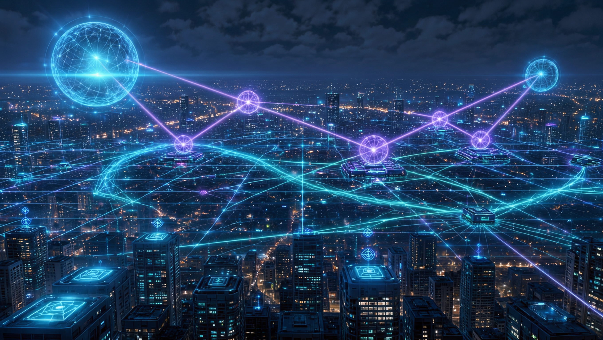

🇧🇷 Português

# O futuro da internet não será todo quântico

A mudança quântica mais próxima da internet pode ser invisível: trocar a criptografia que protege conexões hoje.

Isso não é a mesma coisa que criar uma “internet quântica”.

Criptografia pós-quântica (PQC) roda em computadores comuns e foi projetada para resistir a ataques de computadores clássicos e quânticos. O NIST já publicou três padrões principais, e a migração de protocolos e sistemas está em andamento.

Uma rede quântica é outra tecnologia: conecta dispositivos usando estados quânticos e emaranhamento. A pesquisa da IRTF descreve essa rede como complemento às redes clássicas — não como substituta. Ela poderia apoiar tarefas específicas, como conectar recursos de computação quântica. Não é uma versão mais rápida do Wi-Fi, e a arquitetura ainda está amadurecendo.

Minha leitura: a internet do futuro será híbrida. O tráfego comum continuará em infraestrutura clássica, com criptografia atualizada; segmentos quânticos podem surgir onde suas propriedades forem úteis.

Para times de tecnologia, a ação concreta começa agora: mapear dependências criptográficas e projetar sistemas que permitam trocar algoritmos com menos atrito. Não precisamos prever quando chegará uma internet quântica para preparar a segurança da internet que já usamos.

Fontes: [NIST — PQC](https://www.nist.gov/pqc) · [IRTF — RFC 9340](https://datatracker.ietf.org/doc/rfc9340/)

----------------------------

🇺🇸 English

# The internet’s future won’t be entirely quantum

The nearest quantum shift in the internet may be invisible: replacing the cryptography that protects today’s connections.

That is different from building a “quantum internet.”

Post-quantum cryptography (PQC) runs on ordinary computers and is designed to withstand attacks from classical and quantum computers. NIST has published three major standards, and migration across protocols and systems is underway.

A quantum network is another technology: it connects devices using quantum states and entanglement. The IRTF’s research describes it as a complement to classical networks, not a replacement. It could support specific tasks, such as linking quantum computing resources. It is not faster Wi-Fi, and its architecture is still maturing.

My read: the future internet will be hybrid. Ordinary traffic will stay on classical infrastructure with updated cryptography; quantum segments may appear where their properties are useful.

For technology teams, the practical work starts now: map cryptographic dependencies and design systems that make algorithms easier to replace. We don’t need to predict when a quantum internet will arrive to prepare the security of the internet we already use.

Sources: [NIST — PQC](https://www.nist.gov/pqc) · [IRTF — RFC 9340](https://datatracker.ietf.org/doc/rfc9340/)

## Registro de mídias

- Imagem para LinkedIn: [internet-hibrida-quantica-hero.png](../../../04-midias/futuro-da-internet-computacao-quantica/internet-hibrida-quantica-hero.png) — composição horizontal 16:9, gerada com Kling 4.0 Image via KIE; 11,3 créditos consumidos.
- Conceito: infraestrutura clássica dominante, com conexões quânticas especializadas ao lado dela.
