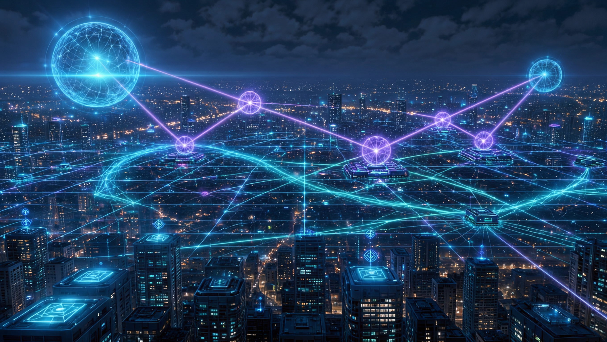

🇧🇷 Português

# O futuro da internet não será todo quântico

*A mudança mais próxima é proteger a internet atual contra futuros computadores quânticos. Uma internet quântica, se amadurecer, será uma camada especializada que trabalha junto das redes clássicas.*

Quando se fala em computação quântica e internet, duas imagens costumam se misturar: a de um computador capaz de quebrar a criptografia que protege dados hoje e a de uma rede quântica que conectaria computadores por emaranhamento. As duas ideias são reais, mas pertencem a estágios e problemas diferentes.

Essa distinção muda a previsão sobre o que vem a seguir. A próxima grande mudança da internet provavelmente não será trocar cabos, roteadores e protocolos por versões quânticas. Será atualizar, de forma gradual e pouco visível, a criptografia que já protege conexões. Redes quânticas podem surgir ao lado dessa infraestrutura para tarefas específicas, sem substituí-la.

## A internet tem um problema quântico antes de ter uma internet quântica

Grande parte da segurança digital depende de problemas matemáticos que são difíceis para computadores clássicos resolverem. Um computador quântico suficientemente avançado poderia mudar esse equilíbrio para algumas técnicas de chave pública. Isso não significa que qualquer computador quântico atual possa abrir conversas, contas bancárias ou conexões TLS. A capacidade necessária ainda não existe em escala prática.

Mas esperar por essa máquina para começar a agir seria uma decisão ruim. Dados capturados hoje podem continuar sensíveis por muitos anos. Um atacante pode armazenar tráfego criptografado e tentar decifrá-lo no futuro, quando houver capacidade suficiente. Por isso, a pergunta para quem opera sistemas não é apenas “quando teremos computadores quânticos poderosos?”, mas “por quanto tempo estes dados precisam continuar secretos?”.

A resposta em andamento é a criptografia pós-quântica (PQC). Apesar do nome, ela não exige computadores quânticos: são algoritmos que rodam em sistemas convencionais e foram projetados para resistir a ataques conhecidos de computadores clássicos e quânticos. O NIST publicou três padrões principais em 2024; organizações e protocolos de internet já trabalham na migração e na compatibilidade dessas proteções. [NIST: padrões de criptografia pós-quântica](https://csrc.nist.gov/Projects/Post-Quantum-Cryptography/Post_Quantum_Cryptography-Standardization) · [NIST: migração para PQC](https://www.nist.gov/pqc)

Na prática, isso envolve inventariar bibliotecas e certificados, descobrir onde sistemas dependem de algoritmos vulneráveis, testar desempenho e interoperabilidade e atualizar componentes sem quebrar clientes antigos. É trabalho de infraestrutura, não uma atualização mágica de botão. O usuário talvez perceba apenas que uma conexão continua funcionando; por baixo, os mecanismos que negociam chaves e assinaturas terão mudado.

## “Pós-quântica” não quer dizer “internet quântica”

Uma confusão comum é tratar a criptografia pós-quântica como a primeira etapa de uma internet feita de qubits. São coisas distintas. PQC protege a internet clássica com novos algoritmos matemáticos. Uma rede quântica, por sua vez, precisa distribuir estados quânticos ou emaranhamento entre dispositivos, algo que não se comporta como copiar e encaminhar pacotes IP.

O RFC 9340, um documento informativo da comunidade de pesquisa da internet, descreve a visão de redes quânticas como complemento às redes clássicas. Bits continuam necessários para coordenação, controle e aplicações comuns. O componente quântico acrescentaria capacidades específicas, como compartilhar emaranhamento entre nós ou conectar processadores quânticos para computação distribuída. O documento também deixa claro que a arquitetura ainda está em desenvolvimento e que aplicações além de alguns casos restritos são mais exigentes. [IRTF: RFC 9340, princípios arquiteturais para uma internet quântica](https://datatracker.ietf.org/doc/rfc9340/)

Essa diferença de função importa. Uma rede quântica não é uma rede Wi-Fi mais rápida, nem um caminho para baixar filmes em menos tempo. Seu valor possível está em tarefas que dependem de propriedades quânticas: distribuir estados entre sistemas, apoiar certos experimentos de comunicação segura ou conectar recursos de computação e medição quânticas. Mesmo aí, “possível” não significa “pronto para uso geral”.

## A internet futura tende a ser híbrida

Por isso, uma projeção mais útil não é “a internet será quântica”, mas “a internet terá camadas clássicas mais resistentes e, talvez, segmentos quânticos especializados”. O tráfego comum — páginas, APIs, vídeo, pagamentos — continuará passando por redes clássicas. A diferença é que protocolos e serviços poderão negociar criptografia pós-quântica e, em alguns ambientes, recorrer a recursos de uma rede quântica para uma tarefa específica.

Esse cenário se parece mais com a evolução real da internet: novas capacidades são incorporadas sem apagar tudo o que já funciona. A migração de criptografia é um exemplo imediato dessa evolução. Uma rede quântica, se demonstrar utilidade e puder ser operada em escala, seria outra camada, com requisitos próprios de hardware, sincronização, memória quântica, correção de erros e controle clássico.

Para equipes de tecnologia, a consequência de curto prazo é concreta: entender onde a criptografia está embutida e planejar agilidade criptográfica, para que algoritmos possam ser trocados sem reescrever sistemas inteiros. Não é necessário apostar em uma data para “a internet quântica”. É necessário saber que segurança tem vida útil: dados, chaves, certificados e protocolos precisam continuar protegidos durante todo o tempo em que ainda importam.

O futuro quântico da internet talvez seja pouco cinematográfico. Primeiro, ele pode aparecer como uma mudança invisível nos padrões de segurança. Depois, se a ciência e a engenharia resolverem problemas de escala, como uma infraestrutura restrita que amplia o que certos sistemas conseguem fazer. O sinal de progresso não será todo pacote virar quântico; será cada tecnologia cumprir uma função definida, com limites conhecidos, dentro de uma rede que continua majoritariamente clássica.

----------------------------

🇺🇸 English

# The internet’s future won’t be entirely quantum

*The nearer change is protecting today’s internet against future quantum computers. A quantum internet, if it matures, will be a specialized layer working alongside classical networks.*

Conversations about quantum computing and the internet often blend two images: a computer capable of breaking encryption that protects data today, and a quantum network connecting computers through entanglement. Both ideas are real, but they address different problems and sit at different stages of development.

That distinction changes what we should expect next. The internet’s next major shift probably won’t replace cables, routers, and protocols with quantum versions. It will be a gradual, mostly invisible update to the cryptography already protecting connections. Quantum networks may emerge alongside that infrastructure for specific tasks, without replacing it.

## The internet faces a quantum security problem before it gets a quantum internet

Much of digital security relies on mathematical problems that classical computers struggle to solve. A sufficiently advanced quantum computer could change that balance for some public-key techniques. This does not mean today’s quantum machines can open private messages, bank accounts, or TLS connections. The required capability does not yet exist at practical scale.

Still, waiting for such a machine before acting would be a poor decision. Data captured today may remain sensitive for years. An attacker could store encrypted traffic and try to decrypt it in the future, once enough computing power exists. That makes the question for system operators more than “When will powerful quantum computers arrive?” It is also “How long must this data remain secret?”

The response already underway is post-quantum cryptography (PQC). Despite its name, it does not require quantum computers. These algorithms run on conventional systems and are designed to withstand attacks from both classical and quantum computers. NIST published three major standards in 2024; organizations and internet protocols are working on migration and compatibility. [NIST: post-quantum cryptography standards](https://csrc.nist.gov/Projects/Post-Quantum-Cryptography/Post_Quantum_Cryptography-Standardization) · [NIST: migrating to PQC](https://www.nist.gov/pqc)

In practice, migration means inventorying libraries and certificates, finding where systems rely on vulnerable algorithms, testing performance and interoperability, and updating components without breaking older clients. This is infrastructure work, not a magic button. A user may only notice that a connection still works; underneath, the mechanisms for negotiating keys and signatures will have changed.

## “Post-quantum” does not mean “quantum internet”

A common mistake is to treat post-quantum cryptography as the first step toward an internet made of qubits. They are different things. PQC protects the classical internet with new mathematical algorithms. A quantum network, by contrast, needs to distribute quantum states or entanglement between devices, which does not behave like copying and forwarding IP packets.

RFC 9340, an informational document from the internet research community, describes quantum networks as a complement to classical networks. Classical bits remain necessary for coordination, control, and ordinary applications. A quantum component could add specific capabilities, such as sharing entanglement between nodes or linking quantum processors for distributed computing. The document also makes clear that the architecture is still developing and that applications beyond a few restricted cases are more demanding. [IRTF: RFC 9340, architectural principles for a quantum internet](https://datatracker.ietf.org/doc/rfc9340/)

That difference in purpose matters. A quantum network is not faster Wi-Fi or a way to download movies sooner. Its potential value lies in tasks that depend on quantum properties: distributing states between systems, supporting certain secure-communication experiments, or connecting quantum computing and sensing resources. Even there, “possible” does not mean “ready for general use.”

## The future internet is likely to be hybrid

So a more useful forecast is not “the internet will be quantum,” but “the internet will gain stronger classical layers and perhaps specialized quantum segments.” Ordinary traffic—web pages, APIs, video, payments—will continue to travel over classical networks. Protocols and services may negotiate post-quantum cryptography and, in some environments, use quantum-network resources for a specific task.

This is closer to how the internet actually evolves: new capabilities are added without erasing everything that already works. Cryptographic migration is an immediate example. A quantum network, if it proves useful and can operate at scale, would be another layer, with its own requirements for hardware, synchronization, quantum memory, error correction, and classical control.

For technology teams, the near-term consequence is concrete: understand where cryptography is embedded and plan for crypto-agility, so algorithms can be replaced without rewriting entire systems. There is no need to bet on a date for “the quantum internet.” There is a need to recognize that security has a time horizon: data, keys, certificates, and protocols must remain protected for as long as they matter.

The quantum future of the internet may look undramatic. First, it may appear as an invisible change to security standards. Later, if science and engineering solve problems of scale, it could become restricted infrastructure that expands what certain systems can do. Progress will not mean every packet becomes quantum. It will mean each technology has a defined role, known limits, and a place in a network that remains mostly classical.

## Publication Notes

- The future capabilities and adoption timeline of quantum networks remain uncertain; the article makes no date prediction.
- “Post-quantum cryptography” and “quantum internet” are treated as distinct technologies.
- Source note: `03-referencias/futuro-internet-computacao-quantica-fontes.md`.

## Registro de mídias

- Capa editorial gerada com Kling 4.0 Image via KIE, em 16:9; 11,3 créditos consumidos. Asset local: [internet-hibrida-quantica-hero.png](../../../04-midias/futuro-da-internet-computacao-quantica/internet-hibrida-quantica-hero.png).
- Conceito: infraestrutura clássica dominante, com conexões quânticas especializadas ao lado dela.
