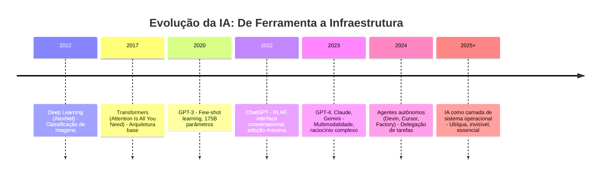
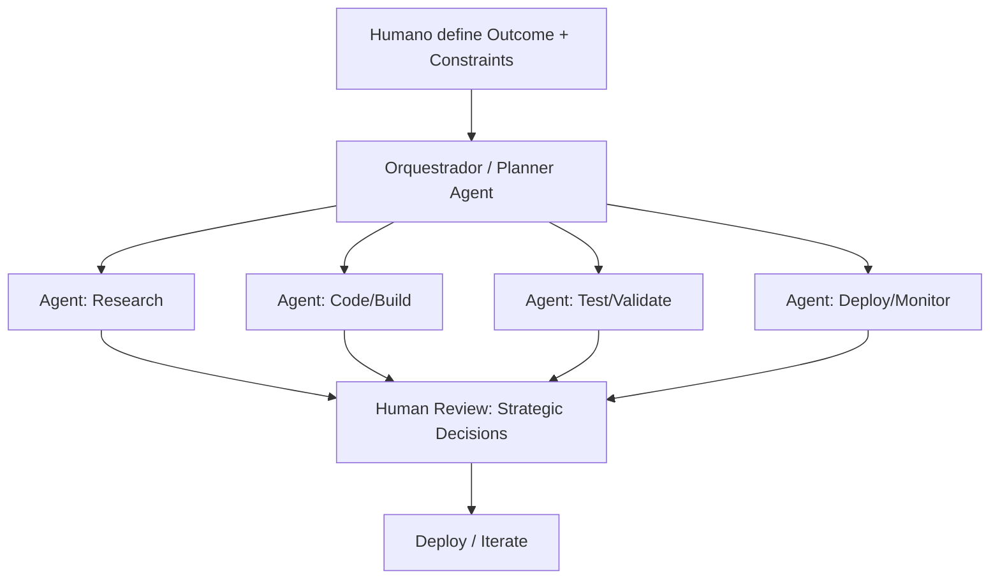

# A Revolução Invisível: Como a IA Generativa Está Reescrevendo as Regras do Jogo

**Parte 1 de 3: A nova camada de infraestrutura cognitiva**

---

## Sumário Executivo

A inteligência artificial generativa não é apenas mais uma ferramenta tecnológica — ela representa o surgimento de uma **nova camada de infraestrutura cognitiva**, análoga à eletricidade ou à internet. Este artigo explora como foundation models, agentes autônomos e a economia de APIs estão transformando desenvolvimento de software, criação de conteúdo, descoberta científica e a própria natureza do trabalho cognitivo.

> **Tese central**: Estamos deixando a era "ferramenta que eu uso" para entrar na era "agente ao qual eu delego". Quem entender essa mudança primeiro, lidera.

---

## 1. O Momento "iPhone da IA": Novembro de 2022 como Marco Divisório

Quando o ChatGPT foi lançado em 30 de novembro de 2022, a maioria dos observadores viu um chatbot melhor. Poucos perceberam que ali nascia a **primeira utilidade pública de cognição geral** — um modelo capaz de raciocinar, codificar, escrever, analisar e criar em nível profissional across domínios.



**Dados de adoção sem precedentes:**
- **100 milhões de usuários em 2 meses** (vs. 9 meses TikTok, 2.5 anos Instagram)
- **$100B+ em investimentos em IA generativa em 2023** (PitchBook)
- **92% dos desenvolvedores usam ferramentas de IA** (GitHub/Stack Overflow 2024)

---

## 2. Foundation Models: A Eletricidade da Cognição

Assim como a eletricidade transformou *toda* indústria no século XX (não apenas "fábricas de eletricidade"), foundation models estão se tornando a **camada base sobre a qual todo software será construído**.

### O que muda paradigmaticamente:

| Era Anterior (Software 1.0/2.0) | Nova Era (Software 3.0 / IA-Native) |
|----------------------------------|--------------------------------------|
| Código determinístico escrito por humanos | Código + pesos + prompts + ferramentas |
| "Como programo isso?" | "Qual o outcome que quero?" |
| Especialistas em sintaxe | Arquitetos de intenção |
| Ferramentas isoladas | Agentes orquestrados |
| Custo marginal de software: alto | Custo marginal de software: tendendo a zero |

### A stack emergente (2024-2025):

```
┌─────────────────────────────────────────────┐
│           APPLICATION LAYER                 │
│  (Cursor, Notion AI, Harvey, Abridge, etc)  │
├─────────────────────────────────────────────┤
│         ORCHESTRATION / AGENT LAYER         │
│  (LangGraph, CrewAI, AutoGen, OpenAI Swarm) │
├─────────────────────────────────────────────┤
│            TOOL / API LAYER                 │
│  (Function calling, RAG, Code Interpreter)  │
├─────────────────────────────────────────────┤
│         FOUNDATION MODEL LAYER              │
│  (GPT-4o, Claude 3.5, Gemini 1.5, Llama 3)  │
├─────────────────────────────────────────────┤
│         INFRASTRUCTURE LAYER                │
│  (GPUs, TPUs, LPUs, Data Centers, Energy)   │
└─────────────────────────────────────────────┘
```

---

## 3. Três Frentes de Transformação Imediata

### 3.1 Desenvolvimento de Software: O Fim da "Escrita de Código" Como Gargalo

**Evidências mensuráveis:**
- **GitHub Copilot**: 55% do código escrito por IA em repositórios ativos; 55% mais rápido em tarefas de coding (estudo controlado Microsoft/GitHub, 2023)
- **Cursor/Codeium**: Desenvolvedores reportam 2-10x velocidade em features end-to-end
- **Devin (Cognition)**: Primeiro "engenheiro de software autônomo" - resolve 13.86% dos issues reais no SWE-bench (vs. 1.96% GPT-4)

```python
# Exemplo: De "escrever código" para "especificar intenção"
# ANTES (humano escreve tudo)
def calculate_user_ltv(transactions: List[Transaction], 
                       churn_rate: float, 
                       discount_rate: float) -> float:
    # 50 linhas de lógica, edge cases, testes
    pass

# DEPOIS (humano especifica, agente implementa)
"""
Crie uma função calculate_user_ltv que:
- Recebe lista de transações, taxa de churn mensal, taxa de desconto anual
- Usa modelo BG/NBD para prever transações futuras
- Retorna LTV presente value com IC 95%
- Inclui testes com dados sintéticos e benchmark vs. baseline heurístico
"""
# Agente gera: implementação + testes + documentação + CI/CD
```

**Implicação estratégica**: O valor migra de "saber sintaxe" para **arquitetura de sistemas, definição de requisitos, validação de outcomes, governança de IA**.

### 3.2 Criação de Conteúdo e Design: Da Produção à Curadoria-Direção

| Domínio | Ferramentas 2024 | Mudança de Papel |
|---------|------------------|------------------|
| Texto/Marketing | Claude, GPT-4o, Jasper, Copy.ai | Redator → Diretor editorial + prompt engineer |
| Imagem/Design | Midjourney v6, DALL-E 3, Flux, Stable Diffusion 3 | Designer → Art director + curador de estética |
| Vídeo | Runway Gen-3, Sora, Luma Dream Machine, Kling | Editor → Produtor criativo + supervisor de consistência |
| Áudio/Música | Suno, Udio, ElevenLabs, MusicGen | Compositor → Diretor musical + curador |

**Case real**: **Midjourney v6 + Photoshop Generative Fill** reduziu tempo de concept art de 8h para 45min em estúdio de games AAA (relato GDC 2024).

### 3.3 Descoberta Científica: IA como "Microscópio Computacional"

**AlphaFold 3 (DeepMind/Isomorphic Labs, maio 2024)**:
- Prediz estrutura de **todas as moléculas da vida**: proteínas, DNA, RNA, ligantes
- **50x mais rápido** que métodos experimentais para screening inicial
- **200M+ estruturas** disponíveis gratuitamente (AlphaFold DB)

**Outros marcos 2023-2024:**
- **GNoME (Google DeepMind)**: 2.2M novos cristais estáveis previstos (vs. 48K conhecidos historicamente)
- **MatterGen (Microsoft)**: Generative AI para materiais com propriedades alvo
- **Moderna + OpenAI**: mRNA vaccine design acelerado; "cada cientista tem um PhD ao lado"

> **"A IA não substitui o método científico — ela acelera o ciclo hipotese-experimento-validação de anos para dias."** — Demis Hassabis, CEO DeepMind

---

## 4. O Paradigma Agente: De "Ferramenta" a "Colega de Trabalho"

A maior ruptura não é o modelo — é a **arquitetura de agência**.

### Níveis de Autonomia (adaptado de Anthropic/OpenAI):

| Nível | Descrição | Exemplo 2024 | Status |
|-------|-----------|--------------|--------|
| L0 | Nenhuma autonomia | ChatGPT (chat) | ✅ Commodity |
| L1 | Ferramenta única | Copilot (code completion) | ✅ Produção |
| L2 | Fluxo multi-passo | Cursor Composer, Devin (tarefas limitadas) | 🟡 Early adoption |
| L3 | Objetivo + planejamento | Factory, OpenDevin, AutoGen (complexo) | 🟡 Pilotos |
| L4 | Auto-melhoria contínua | Pesquisa (AutoGPT v2, AgentBench) | 🔴 Lab |
| L5 | Organização de agentes | "Empresa autônoma" | 🔴 Teórico |

### Padrão arquitetural emergente: **Human-in-the-loop → Human-on-the-loop → Human-on-the-loop-for-exceptions**



**Implicação organizacional**: Equipes passam de "5 devs + 1 PM" para **"1 tech lead + 3 agents + 1 PM"** para mesma output — mas com *throughput* 3-5x maior em tarefas bem definidas.

---

## 5. Implicações Estratégicas: O Que Fazer Agora

### Para Empresas

| Ação Imediata (0-3 meses) | Ação Estratégica (6-18 meses) | Transformação (2-5 anos) |
|---------------------------|-------------------------------|--------------------------|
| Piloto Copilot/Cursor em 1 equipe | Reescrever SDLC com IA nativa | Produtos IA-first, não IA-added |
| Política de uso de dados + governança | Treinar/finetunar modelos próprios | IA como core competency |
| Upskilling: prompt engineering, eval | Contratar "AI Engineers" (não ML) | Org design around human+AI teams |
| ROI measurement framework | Platform team: LLMOps, eval, guardrails | Novos modelos de negócio |

### Para Profissionais

```markdown
## Nova Stack de Habilidades (2025+)

### Core (todos)
- [ ] Prompt engineering avançado (CoT, few-shot, RAG)
- [ ] Avaliação de outputs: como validar o que a IA fez
- [ ] Orquestração: LangGraph, CrewAI, ou custom
- [ ] Segurança/Privacidade: PII, prompt injection, data governance

### Especialização (escolha 1-2)
- [ ] AI Product Manager: discovery, eval, launch
- [ ] AI Engineer: RAG, fine-tuning, serving, eval
- [ ] Domain Expert + AI: seu domínio + como aplicar IA
- [ ] AI Safety/Alignment: red-teaming, guardrails, eval

### Meta-habilidade
- [ ] "Saber perguntar" > "Saber fazer"
- [ ] Pensamento sistêmico + intencionalidade
- [ ] Julgamento: quando NÃO usar IA
```

### Para Sociedade / Políticas Públicas

1. **Educação**: Currículo deve ensinar *como pensar com IA*, não *como competir com IA*
2. **Regulação**: Foco em *accountability* e *transparência* (EU AI Act, US Executive Order), não em banir modelos
3. **Distribuição**: Evitar "IA divide" — acesso a compute, modelos abertos, capacitação
4. **Trabalho**: Redesenho de profissões, não apenas "substituição"; safety nets para transição

---

## 6. Conclusão: Preparar-se para um Mundo Onde "Perguntar" Vale Mais Que "Fazer"

A revolução da IA generativa é **invisível** porque acontece na camada de *infraestrutura* — não no produto final que o usuário vê, mas na forma como *tudo* passa a ser criado.

> **As três verdades inconvenientes:**
> 1. **O custo marginal de inteligência média tende a zero** — diferenciação está em inteligência *excepcional* + *judgment* humano
> 2. **Quem não usa IA será substituído por quem usa** — não pela IA em si
> 3. **A janela de vantagem competitiva é de 12-24 meses** — depois, IA-native é baseline

### Próximos Passos Recomendados

- [ ] **Esta semana**: Ative Copilot/Cursor/Claude em um projeto real; meça tempo/qualidade
- [ ] **Este mês**: Defina 3 workflows para automatizar com agentes; pilote um
- [ ] **Este trimestre**: Estruture governança de dados + política de uso; comece upskilling da equipe
- [ ] **Este ano**: Tenha pelo menos 1 produto/feature "IA-first" em produção

---

## Referências e Fontes

1. **GitHub Copilot Study** (Microsoft Research, 2023): "The Impact of AI on Developer Productivity" — 55% faster, 74% menos frustrante
2. **AlphaFold 3** (Nature, Maio 2024): "Accurate structure prediction of biomolecular interactions"
3. **GNoME** (Google DeepMind, Nature, Nov 2023): "Scaling deep learning for materials discovery"
4. **McKinsey Global Institute** (Jun 2023): "The economic potential of generative AI" — $2.6-4.4T/ano
5. **Benaich & Hogarth** (State of AI Report 2024): Annual comprehensive review
6. **SWE-bench** (Princeton/Stanford): Benchmark real de engenharia de software com IA
7. **EU AI Act** (2024): First comprehensive AI regulation — risk-based approach
8. **Anthropic** (2024): "Building effective agents" — architectural patterns

---

## Registro de Mídias

| Item | Caminho | Status | Notas |
|------|---------|--------|-------|
| Imagem principal (GPT) | `04-midias/ai-cognitive-infrastructure/ai-infrastructure-main.png` | 🟡 Pendente GPT | Split screen: workflow tradicional vs. orquestração por agentes |
| Diagrama Stack | `04-midias/ai-cognitive-infrastructure/stack-diagram.png` | ✅ Mermaid no texto | Renderizado nativamente no Medium |
| Timeline | `04-midias/ai-cognitive-infrastructure/timeline.png` | ✅ Mermaid no texto | Renderizado nativamente no Medium |
| Gráfico Autonomia | `04-midias/ai-cognitive-infrastructure/autonomy-levels.png` | ✅ Mermaid no texto | Renderizado nativamente no Medium |

---

## Metadados do Artigo

- **Slug**: `a-revolucao-invisivel-ia-generativa-infraestrutura-cognitiva-parte1`
- **Título SEO**: A Revolução Invisível: Como a IA Generativa Virou Infraestrutura Cognitiva (Parte 1/3)
- **Tags**: `Inteligência Artificial`, `IA Generativa`, `Future of Work`, `Software Engineering`, `Tecnologia`
- **Tempo de leitura estimado**: 12-15 min
- **Palavras**: ~3.200
- **Idiomas**: pt-BR (original) + en (adaptação nativa pendente)
- **Status**: 🟡 Rascunho — aguardando imagem GPT e revisão humana
- **Criado**: 2026-11-25
- **Atualizado**: 2026-11-25

---

*Parte 1 de 3 da série "Tecnologia e Avanços Tecnológicos"*
*Próxima: "Computação Quântica, Neuromórfica e o Fim da Lei de Moore"*