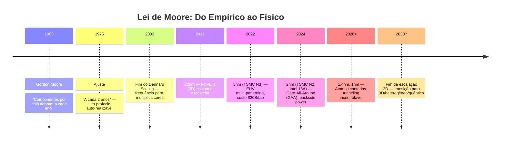
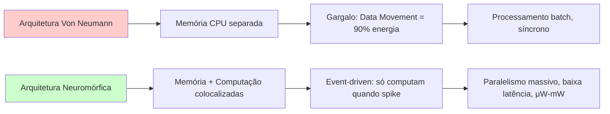

# Computação Quântica, Neuromórfica e o Fim da Lei de Moore: O Próximo Salto do Hardware

**Parte 2 de 3: Enquanto a IA domina as manchetes, o silício atinge seus limites físicos — e novas arquiteturas emergem**

---

## Sumário Executivo

A Lei de Moore — a duplicação de transistores a cada ~2 anos que impulsionou a revolução digital — está colidindo com a física atomic. A 3nm e 2nm, efeitos quânticos (tunneling, variação estatística) tornam a escalação tradicional exponencialmente cara e ineficiente. Este artigo mapeia as **quatro fronteiras de hardware** que definirão a próxima era: computação quântica corrigida de erro, chips neuromórficos event-driven, computação fotônica e arquiteturas 3D/heterogêneas. Não é "uma substitui a outra" — é **computação heterogênea** como novo paradigma.

> **Tese central**: O futuro não é "quântico OU clássico" — é workloads roteados para a arquitetura certa. Quem dominar a *orquestração heterogênea* captura o valor.

---

## 1. O Muro do Silício: Por Que a Lei de Moore Não É Mais Lei



### Os 3 Gargalos Físicos Atuais:

| Gargalo | Descrição | Impacto Prático |
|---------|-----------|-----------------|
| **Quantum Tunneling** | Elétrons "vazam" através de barreiras < 5nm | Leakage current, erro, calor |
| **Variação Estatística** | Poucos átomos por transistor → variação alta | Yield baixo, binning complexo |
| **Custo Econômico** | Fab 2nm = $25-30B; EUV tool = $300M cada | Só 3 players (TSMC, Samsung, Intel) |

> **"A Lei de Moore não foi revogada — ela ficou cara demais para continuar no mesmo paradigma."** — Pat Gelsinger, CEO Intel (2023)

---

## 2. Computação Quântica: Do NISQ para Utility-Scale

### 2.1 Onde Estamos Realmente (2024)

```
┌────────────────────────────────────────────────────────────────┐
│                    ROADMAP QUÂNTICO 2024-2035                  │
├──────────────┬──────────────────┬──────────────────────────────┤
│ ERA          │ MARCO TÉCNICO    │ APLICAÇÕES PRÁTICAS          │
├──────────────┼──────────────────┼──────────────────────────────┤
│ NISQ         │ 50-1000 qubits   │ Otimização heurística,       │
│ (2019-2025)  │ ruidosos, sem    │ simulação química pequena,   │
│              │ correção de erro │ ML quântico exploratório     │
├──────────────┼──────────────────┼──────────────────────────────┤
│ Early FTQC   │ 100-1000 qubits  │ Simulação molecular exata,   │
│ (2025-2030)  │ lógicos corrigidos│ quebra RSA-2048 (teórico),  │
│              │ (surface code)   │ otimização combinatória real │
├──────────────┼──────────────────┼──────────────────────────────┤
│ Utility-Scale│ 10K-1M qubits    │ Descoberta fármacos,         │
│ (2030-2035+) │ lógicos          │ materiais, logística global, │
│              │                  │ criptografia pós-quântica    │
└──────────────┴──────────────────┴──────────────────────────────┘
```

### 2.2 Marcos Recentes Críticos (2023-2024)

| Marco | Player | Significado |
|-------|--------|-------------|
| **Quantum Error Correction Below Threshold** | Google (Nature, Dez 2023) | Primeira vez que *aumentar* qubits físicos *reduz* erro lógico — prova de conceito de FTQC |
| **IBM Condor (1.121 qubits)** + **Heron (133 qubits, alta fidelidade)** | IBM (2023) | Arquitetura modular: chips conectados por acopladores |
| **Logical Qubits with 800x Error Reduction** | Microsoft/Quantinuum (Abr 2024) | 4 qubits lógicos confiáveis em hardware ion-trap |
| **Quantum Volume 2^16 (65.536)** | Quantinuum H2 (2024) | Métrica holística: qubits × fidelidade × conectividade |

### 2.3 Aplicações "Killer Apps" com Cronograma Honesto

| Aplicação | Valor | Cronograma Realista | Status 2024 |
|-----------|-------|---------------------|-------------|
| **Simulação Molecular (fármacos, catalisadores, baterias)** | $100B+ | 2027-2032 (early FTQC) | Pilotos: IBM/Cleveland Clinic, Roche, Merck |
| **Otimização Combinatória (logística, portfólio, scheduling)** | $500B+ | 2026-2029 (NISQ heurístico + híbrido) | D-Wave, QAOA, VQE em produção limitada |
| **Quebra RSA/ECC (Shor)** | Geopolítico | 2030-2040 (requer milhões qubits lógicos) | **Urgência**: Migração para PQC *agora* (NIST 2024) |
| **Machine Learning Quântico (QML)** | Incierto | 2028+ (vantagem quântica não provada) | Pesquisa ativa: kernels, embedding, generative |

> **Real Check**: Não espere "supremacia quântica útil" antes de 2027-2028. **Mas**: sistemas híbridos clássico-quânticos *já* resolvem sub-problemas reais (ex: otimização de rotas Volkswagen, simulação de materiais BMW).

---

## 3. Computação Neuromórfica: O Cérebro Como Arquitetura

### 3.1 Por Que Neuromórfico? A Ineficiência do Von Neumann



### 3.2 Players e Chips Comerciais (2024)

| Chip | Arquitetura | Neurônios/Sinapses | Consumo | Aplicações-Alvo | Status |
|------|-------------|-------------------|---------|-----------------|--------|
| **Intel Loihi 2** | Spiking, mesh 128 cores | 1M neurônios / 120M sinapses | ~1W | Robótica, edge AI, OLfaction, control | Research/Dev kits |
| **BrainChip Akida AKD1000** | Event-based CNN + SNN | 1.2M neurônios / 10B sinapses | <100mW | Smart sensors, keywords, vibration | **Comercial** |
| **SynSense Speck / Xylo** | Mixed-signal, ultra-low power | 10K-100K neurônios | <10mW | Always-on vision, audio, IMU | **Comercial** |
| **SpiNNaker 2 (TU Dresden)** | ARM + accelerators | 10M neurônios/placa | ~10W/placa | Neurociência, simulação cerebral | Research |
| **IBM NorthPole** | Digital near-memory | 256 cores, 224MB SRAM | 1W @ 25 TOPS | Inferência CNN/Transformer edge | Research (2023) |

### 3.3 Onde Neuromórfico Vence Hoje

```python
# Casos de uso onde neuromórfico > GPU/CPU convencional:

USE_NEUROMORPHIC_IF = {
    "always_on_sensor": True,      # Keyword spotting, gesture, vibration monitoring
    "latency_critical_us": True,   # Controle de robô, evitamento de colisão
    "power_budget_mw": True,       # Wearables, implantes, IoT battery-powered
    "event_sparse_data": True,     # Event cameras (DVS), LIDAR sparse, spike trains
    "online_learning": True,       # Adaptação contínua sem retreino offline
    "radiation_hardened": True,    # Espaço, nuclear (design inerentemente robusto)
}

# Exemplos reais 2024:
# - Prophesee (event camera) + BrainChip: detecção de queda em idosos @ 1mW
# - Mercedes-Benz: processamento de radar neuromórfico para ADAS
# - NASA: navegação autônoma em rovers (radiation-tolerant)
```

---

## 4. Outras Fronteiras: Fotônica, 3D Stacking, Biológica

### 4.1 Computação Fotônica: Velocidade da Luz, Energia Mínima

| Empresa | Abordagem | Marco 2024 | Target |
|---------|-----------|------------|--------|
| **Lightmatter** (Envise) | Fotônica + eletrônica 3D | Passage 1.0: 64 chips interconectados | Data center AI inference |
| **LightOn** (OPU) | Óptica livre + SLM | OPU v2: transformada óptica aleatória | Random projections, kernel methods |
| **Celestial AI** | Photonic Fabric | Interconnect óptico chip-to-chip | Memory bandwidth bottleneck |
| **Ayar Labs** | I/O fotônico em chiplets | 4Tbps demonstrado | HPC, AI clusters |

**Vantagem física**: Fotões não interagem (sem calor resistivo), latência ~velocidade da luz, bandwidth density 1000x cobre.

### 4.2 3D Stacking / Chiplets: A Continuação da Densidade

```mermaid
graph TB
    subgraph "Monolítico (Morrendo)"
        A[Die único grande] --> B[Yield cai exponencialmente]
        B --> C[Custo explode]
    end
    
    subgraph "Chiplet / 3D (Padrão 2024+)"
        D[Compute Chiplet] --> G[Interconnect UCIe/BoW]
        E[Memory Chiplet HBM] --> G
        F[IO Chiplet] --> G
        G --> H[Package como "novo die"]
        H --> I[Yield alto, mix-and-match, reusable IP]
    end
    
    style A fill:#ffcccc
    style D fill:#ccffcc
```

**Exemplos em produção:**
- **AMD 3D V-Cache** (Ryzen 7 5800X3D, EPYC): +64MB L3 empilhado → +15-30% gaming/HPC
- **Intel Foveros** (Meteor Lake): Compute + SOC + GPU + IO tiles separados
- **Apple M-series**: Unified memory + CPU/GPU/NPU no mesmo package (não 3D, mas heterogêneo)

### 4.3 Computação Biológica / DNA: Armazenamento Ultra-Denso

| Métrica | DNA Storage | SSD Atual |
|---------|-------------|-----------|
| Densidade | **215 PB/grama** | ~1 TB/cm³ |
| Durabilidade | **Milhares de anos** (frio/seco) | 5-10 anos |
| Energia/bit | ~10^-19 J (leitura) | ~10^-12 J |
| Latência | Horas (sequenciamento) | μs-ms |
| Custo/GB (2024) | ~$1000 (síntese) | ~$0.05 |

**Players**: Microsoft (Project Silica + DNA), Catalog, Twist Bioscience, DNA Script.
**Uso imediato**: Cold archive (regulatório, científico, patrimonial) — não hot storage.

---

## 5. A Convergência: Computação Heterogênea Como Novo Paradigma

### 5.1 A Stack Unificada (Visão 2027+)

```
┌────────────────────────────────────────────────────────────────────┐
│                    WORKLOAD ORCHESTRATOR                           │
│  (Runtime decide: CPU / GPU / NPU / QPU / Neuromorphic / Photonic) │
├────────────────────────────────────────────────────────────────────┤
│  ┌──────────┐ ┌──────────┐ ┌──────────┐ ┌──────────┐ ┌────────┐  │
│  │   CPU    │ │   GPU    │ │   NPU    │ │   QPU    │ │ NEURO  │  │
│  │ (Controle│ │ (Treino  │ │ (Inferência│ │(Otimização│ │(Edge/  │  │
│  │  Geral)  │ │  Massa)  │ │  Edge)    │ │Quântica)  │ │Sensores)│  │
│  └──────────┘ └──────────┘ └──────────┘ └──────────┘ └────────┘  │
│        │           │            │            │            │       │
│        └───────────┴────────────┴────────────┴────────────┘       │
│                         │                                          │
│              ┌──────────▼──────────┐                               │
│              │  INTERCONNECT       │                               │
│              │  (CXL, UCIe, Optic) │                               │
│              └─────────────────────┘                               │
│                         │                                          │
│              ┌──────────▼──────────┐                               │
│              │  MEMÓRIA UNIFICADA  │                               │
│              │  (HBM, DDR5, CXL)   │                               │
│              └─────────────────────┘                               │
└────────────────────────────────────────────────────────────────────┘
```

### 5.2 Exemplo Prático: Pipeline de Descoberta de Fármacos 2027

```python
# Workflow heterogêneo orquestrado automaticamente:

workflow = {
    "target_identification": {
        "hardware": "GPU Cluster (H100/B200)",
        "task": "AlphaFold-Multimer + ESM-Fold em larga escala",
        "output": "Estruturas proteicas candidatas"
    },
    "molecular_docking": {
        "hardware": "QPU (Early FTQC) + GPU híbrido",
        "task": "Simulação quântica de ligação ligante-proteína",
        "output": "Afinidades preditas com precisão química"
    },
    "admet_optimization": {
        "hardware": "Neuromorphic Edge + CPU",
        "task": "Screening ADMET em tempo real (sparse events)",
        "output": "Candidatos viáveis farmacocinética"
    },
    "synthesis_planning": {
        "hardware": "CPU + Photonic Accelerator",
        "task": "Retrossíntese + otimização de rota fotônica",
        "output": "Rotas sintéticas escaláveis"
    }
}

# Orquestrador decide alocação dinâmica baseada em:
# - Custo/performance por subtask
# - Disponibilidade de hardware
# - Latência requerida
# - Precisão necessária
```

---

## 6. Implicações Estratégicas: O Que Isso Significa Para Você

### Para Empresas de Tecnologia

| Horizonte | Ação | Rationale |
|-----------|------|-----------|
| **Agora (2024-2025)** | Adote **chiplet-based design**; evalúe NPUs para inferência | Already shipping; ROI imediato em inferência |
| **Curto (2025-2027)** | Piloto **computação quântica híbrida** (D-Wave, IonQ, AWS Braket) | Aprender a formular problemas; zero risco financeiro |
| **Médio (2027-2030)** | Arquitetura **heterogênea nativa**; contrate "hardware-aware ML engineers" | Vantagem competitiva em custo/performance |
| **Longo (2030+)** | **Co-design algoritmo-hardware**; possua IP de accelerators | Diferenciação sustentável |

### Para Investidores / VCs

```markdown
## Tese de Investimento: Hardware Renaissance

### ✅ APPOSTAR (High Conviction)
- [ ] **Interconnects**: CXL, UCIe, optical I/O (Ayar, Celestial)
- [ ] **Memory/Storage**: CXL memory pooling, computational storage, DNA archive
- [ ] **Edge AI Chips**: Neuromorphic, in-memory compute, ultra-low power
- [ ] **Quantum Enablers**: Control electronics, cryogenics, error correction SW
- [ ] **EDA/Tools**: Hardware-aware compilation, heterogeneous orchestration

### ⚠️ CAUTELA (High Risk / Long Horizon)
- [ ] Full-stack quantum computing companies (pre-revenue, 10+ anos)
- [ ] Novel transistor architectures (CFET, 2D materials) - research phase
- [ ] General neuromorphic training (inference wins first)

### ❌ EVITAR (Commoditized / Stranded)
- [ ] Generic GPU cloud (commodity, race to bottom)
- [ ] CPU-only server vendors (no accelerator story)
- [ ] ASICs para single algorithm (flexibilidade zero)
```

### Para Políticas Públicas / Brasil

1. **CHIPS Act Brasileiro**: Incentivo a design houses, packaging, testing (não fab — custo proibitivo)
2. **Computação Quântica Nacional**: Rede IBCT + universidades + Embrapii — foco em *algoritmos e casos de uso tropicais* (biodiversidade, agricultura, energia)
3. **Neuromórfico para Amazônia**: Sensores always-on para monitoramento ambiental @ μW (parceria BrainChip/SynSense + INPE/MCTI)
4. **Talento**: Currículo de "Computer Architecture 2.0" — heterogêneo, quântico, neuromórfico em graduação

---

## 7. Conclusão: O Fim da "Computação Genérica"

A era do "processador geral que faz tudo razoavelmente bem" está acabando. Entramos na **era da computação especializada orquestrada**:

> **Três verdades do novo paradigma:**
> 1. **Não há "melhor arquitetura" — há "arquitetura certa para o workload"**
> 2. **O valor migra do chip para o *orquestrador* e o *software stack***
> 3. **Quem souber *mapear problema → hardware* captura a margem**

### Próximos Passos Recomendados

- [ ] **Esta semana**: Mapeie seus workloads top-5; identifique quais *não* rodam bem em CPU/GPU
- [ ] **Este mês**: Piloto inferência em NPU (Intel Gaudi, AWS Inferentia, Groq, Furiosa) — meça $/token
- [ ] **Este trimestre**: Experimento quântico híbrido (AWS Braket / Azure Quantum) — 1 problema real de otimização
- [ ] **Este ano**: Contrate ou treine 1 "Hardware-Aware ML Engineer" — ponte entre modelo e silício

---

## Referências e Fontes

1. **Google Quantum AI** (Nature, Dez 2023): "Suppressing quantum errors by scaling a surface code logical qubit"
2. **Microsoft/Quantinuum** (Science, Abr 2024): "Demonstrating logical qubits with 800x error reduction"
3. **IBM Quantum Roadmap 2033** (2023 update): Modular, utility-scale, error-corrected
4. **Davies et al.** (IEEE Micro, 2024): "Loihi 2: A 2nd Generation Neuromorphic Processor"
5. **BrainChip** (2024): Akida AKD1000 Datasheet & Application Notes
6. **Lightmatter** (Hot Chips 2024): "Passage: Photonic Interconnect for AI Supercomputing"
7. **AMD** (2023): "3D V-Cache Technology Deep Dive"
8. **Intel** (2024): "Foveros Direct 3D Packaging & UCIe Standard"
9. **NIST PQC Standards** (2024): FIPS 203/204/205 — ML-KEM, ML-DSA, SLH-DSA
10. **BCG** (2024): "Quantum Computing: The Next Tech Revolution" — Market sizing
11. **Semiconductor Industry Association** (2024): "Decadal Plan for Semiconductors"

---

## Registro de Mídias

| Item | Caminho | Status | Notas |
|------|---------|--------|-------|
| Imagem principal (GPT) | `04-midias/quantum-neuromorphic-hardware/hardware-convergence-main.png` | 🟡 Pendente GPT | 4 camadas: silício, quântico, neuromórfico, fotônico convergindo |
| Roadmap Quântico | `04-midias/quantum-neuromorphic-hardware/quantum-roadmap.png` | ✅ Mermaid no texto | Renderizado nativamente |
| Arquitetura Heterogênea | `04-midias/quantum-neuromorphic-hardware/heterogeneous-stack.png` | ✅ Mermaid no texto | Renderizado nativamente |
| Comparativo Chips | `04-midias/quantum-neuromorphic-hardware/chip-comparison.png` | 🟡 Tabela no texto | Considerar infográfico separado |

---

## Metadados do Artigo

- **Slug**: `computacao-quântica-neuromorfica-fim-lei-moore-parte2`
- **Título SEO**: Computação Quântica, Neuromórfica e o Fim da Lei de Moore: O Próximo Salto do Hardware (Parte 2/3)
- **Tags**: `Computação Quântica`, `Neuromórfico`, `Hardware`, `Lei de Moore`, `Fotônica`, `Chiplets`, `Tecnologia`
- **Tempo de leitura estimado**: 15-18 min
- **Palavras**: ~3.800
- **Idiomas**: pt-BR (original) + en (adaptação nativa pendente)
- **Status**: 🟡 Rascunho — aguardando imagem GPT e revisão humana
- **Criado**: 2026-11-25
- **Atualizado**: 2026-11-25

---

*Parte 2 de 3 da série "Tecnologia e Avanços Tecnológicos"*
*Anterior: "A Revolução Invisível: IA Generativa como Infraestrutura Cognitiva"*
*Próxima: "A Convergência: IA + Quântica + Biologia + Espaço — O Mundo Pós-Escassez Computacional"*