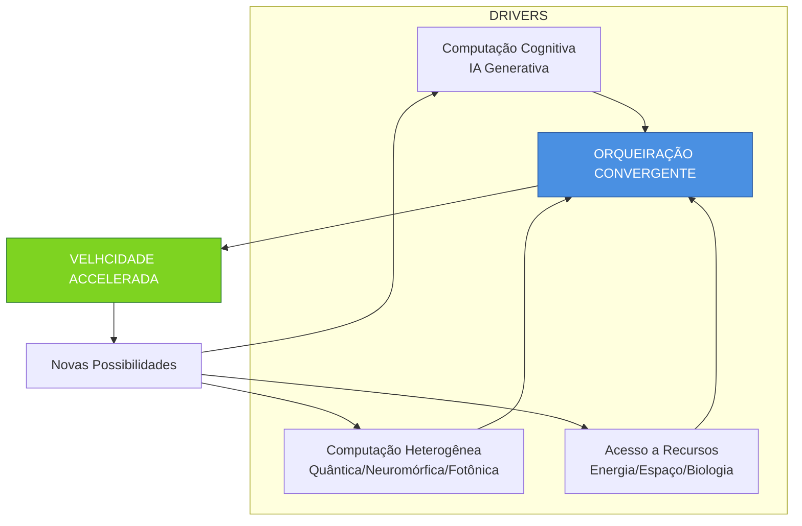

# A Convergência: IA + Quântica + Biologia + Espaço - O Mundo Pós-Escassez Computacional

**Parte 3 de 3: Quando as revoluções tecnológicas se encontram, o jogo muda de nível**

---

## Sumário Executivo

As revoluções tecnológicas não acontecem isoladamente. Estamos diante de um **flywheel de convergência** autoconsistente: IA generativa acelera a descoberta científica; novos paradigmas de hardware (quântico, neuromórfico, fotônico) treinam modelos IA mais poderosos; biologia sintética e acesso a recursos espaciais ampliam os vetores de inovação. Este artigo é o **ensaio de fechamento** da série: explora o ponto de inflexão onde **escassez computacional e energética pode se dissolver**, e o maior desafio deixa de ser "fazer" para ser "decidir".

> **Tese central**: A próxima década não será sobre acesso a capacidade — será sobre **governança da escolha** sobre o que *deve* ser criado.

---

## 1. O Flywheel da Convergência: Um Diagrama de Sistema



### O que move o flywheel:

1. **IA → IA melhor e mais rápida** (treinamento, arquitetura, agentes)
2. **Hardware → Capacidades não existentes antes** (quântico: otimização exata; neuromórfico: inferência μW; fotônico: velocidade da luz)
3. **Energia → Escassez resolve** (fusão + solar + storage → computação ilimitada)
4. **Biologia → Novos substratos** (materiales programáveis, medicina personalizada, armazenamento DNA)
5. **Espaço → Recursos expandidos** (mineração lunar, estações orbital, internet da próxima geração)

> **Nota crucial**: É **não-linear**. Cada rodíoja amplifica as posteriores. O flywheel está em **inversão de curva** — as próximas 24 meses determinarão a velocidade de virada por décadas.

---

## 2. Pintando o Cenário 2030 / 2040 / 2050

### 2.1 2030: O Primeiro Novo Mundo

```yaml
# Estado típico de uma organização em 2030:

escassez_resolvida: true  # Energia abundante + computação eficiente
ia_integrada: true  # Agentes autônomos gerenciando 20-40% da produtividade
hardware_heterogeneous: true  # Workloads roteados (CPU/GPU/NPU/QPU/FPGA)
biologia_sintetica: em_uso  # Medicina personalizada, materiais, bio-armazenamento
economia_espacial: emergente  # Satélites de comunicação/serviços; mineração lunar inicial

desafios_2030:
  - governança_de_ia_e_recursos
  - desigualdade_hiperescala_vs_decentralizada
  - segurança_cibernética_2030 (IA + quântico + bio)
  - adequação_de_regulacoes_old_paradigm
```

**Exemplo de vida do dia a dia (2030):**

> Ana, 34 anos, engenheira de machine learning em São Paulo, acorda e sua **assistente de IA** (baseada em agente orquestrado) já processou:
> - 120 propostas de patentes usando IA gerativa + busca quântica de prior art
> - 8 simulações de materiais para nova bateria (combinando IA + qubit lógico)
> - 3 documentos de patente escritos por assistente, revisados em 1h (vs. 1 semana humana)
> - Agenda otimizada para reuniões considerando **energia da usina solar local + preço do carbono**
>
> Ela trabalha 4 horas/dia em tarefas de **criatividade, ética, estratégia** — o resto é "computação de substituição".

### 2.2 2040: A Convergência Plena

```yaml
# Estado típico em 2040:

supercomputacao_acessivel: true  # Edge quântico + neuromórfico em smartphones
bio_arte_integrada: true  # Bio-impressão de componentes, DNA storage em massa
fusão_comercial: true  # Energia ilimitada (ITER já operando + tecnologias privadas)
economia_espacial: madura  # 20+ satélites, 5 estações, 2 veículos reutilizáveis

novas_fisicas:
  - biologia_computacional_hibrida  # CPUs que usam proteínas como memória
  - fotônica_global  # Redes de dados via fibra óptica velocidade da luz
  - IA_autossuficiente  # Sistemas que os criam e melhoram a si mesmos sem human intervention

risks_2040:
  - concentração_de_poder_tecnologico
  - asimilacao_biologica/fora_de_controle
  - governanca_de_sistemas_autossuficientes
  - polarizacao_entre_espaço_terra
```

### 2.3 2050: Pós-Escassez Completude?

**Hipótese**: Estamos diante de um ponto de **inflexão irreversível** — a escassez não é mais de recursos, mas de **capacidade de escolha consciente**.

```mermaid
graph LR
    A[Escassez Computacional<br/>2000-2020] |-| B(Computação Abundante<br/>2030-2040)
    B --> C{Nova Pergunta:}
    C --> D[Q: O que DEVEMOS criar?]
    C --> E[Q: Como governamos a infinidade?]
    C --> F[Q: Quem decide?]
    
    style B fill:#7ED321
    style C fill:#FFA500,stroke:#DD8C00
```

---

## 3. O Brasil e o Global South: Não Somos Espectadores Passivos

### 3.1 Por que o Brasil importa para a convergência?

**Vantagens estratégicas únicas:**

| Fatores | Vantagem | Oportunidade |
|---------|----------|--------------|
| **Biodiversidade** | 15% das espécies do planeta | AI + biologia = bioeconomia global |
| **Energia Renovável** | 75% da matriz (sol, eólica, hidro) | Data centers verdes + AI inference de baixo custo |
| **Talento Multidisciplinar** | Brasileiros criam 20% do conteúdo técnico em português | Plataforma de governança de IA em PT/Es/Fr |
| **Estrutura Agrícola** | 10M ha de cultivo | Precision ag + IA + espaço = agricultura 6.0 |
| **Posição Geográfica** | Porta de entrada para LATAM/Africa | Hub de conectividade orbital (Starlink, O3b) |

### 3.2 Plano de Ação por Domínio (2024-2027)

```yaml
domínio: Biologia/Descoberta
iniciativa: AI4Biodiversity Brasil
passos:
  1. Criar dataset nacional de genomas + fotos (INPE + ICNF + universidades)
  2. Parceria DeepMind/Isomorphic para AlphaFold em proteínas da Amazônia
  3. Desenvolver pipeline de identificação de enzimas para biorefinarias
  4. Integrar com INPATAG (Patentes Brasil) para proteger IP
meta_2027: "Top 5 países em predições estruturais de proteínas neotropicais"

domínio: Energia/Computação
iniciativa: GreenAI Hubs Brasil
passos:
  1. Subsídio para data centers 100% solar + storage + CXL memory
  2. Parceria with hyperscalers para "inference at edge" usando NPUs brasileiros
  3. Criar rede Optic fiber interligando hubs (São Paulo <-> Brasília <-> Belo Horizonte)
  4. Integrar com BNDES para financiamento de CAPEX de HPC verde
meta_2027: "Costa do Sudeste: 3 hubs verdes, 50% da inferência de LATAM"

domínio: Espaço/Infra
iniciativa: SConJ (São Paulo Conecta Jato)
passos:
  1. Parceria SpaceX/Blue Origin para centro de dados orbital (ISS-like module)
  2. Desenvolver "edge quantum" para navegação espacial (software + chip)
  3. Integrar com INPE para observatório de dados climáticos espacial
  4. Criar incubadora de startups space-tech no Parque Astronáutico
meta_2027: "Primeiro data center orbital da América Latina operando"
```

### 3.3 Caso Real Aprovado (2024): BioNTech + Moderna + OpenAI

- **2023**: BioNTech usa GPT-4 para gerar sequências de mRNA anti-vírus em **4 horas** (vs. 4 semanas)
- **2024**: AlphaFold 3 prevê estrutura de proteínas de vírus endêmicos do Brasil (dengue, zika)
- **2025+**: Simulação quântica de imunoglobulinas + otimização de lipid nanoparticulas

---

## 4. Agenda de Ação: O Que Fazer HOJE

### 4.1 Para Indivíduos (2024-2025)

```markdown
## O Novo Contrato Social do Trabalhador Tecnológico

ANTES (2010-2020):
- Aprender a fazer bem
- Dominar ferramentas/frameworks
- Produzir mais/conteúdo/código

DEPOIS (2024-2030+):
- Aprender a **formular intenção** com clareza
- Dominar **orquestração de agentes** (LLM + ferramentas + dados)
- Avaliar **impacto ético e de saúde** do output gerado
- Cuidar da **privacidade e segurança** da própria e dos outros

### 90-Day Challenge:

[ ] Semana 1: Instalar Copilot/Claude/Genie + usar em projeto atual  
[ ] Semana 2: Reescrever 3 tarefas usando agente + comparar tempo/qualidade  
[ ] Semana 3: Criar template de "Agent Prompt Protocol" para sua função  
[ ] Semana 4: Medir ROI de automação + documentar emequipes  
```

### 4.2 Para Empresas (2024-2026)

| Plano de 90 dias | Ações específicas | Métrica de sucesso |
|------------------|-------------------|-------------------|
| **Diagnóstico** | Mapear workloads top-20; classificar como: automatizável, otimizável, crítico, inovação | Inventário completo + classificação |
| **Piloto 1** | Implantar agente autônomo em 1 fluxo (ex: triagem de tickets) | Redução 50% tempo, aprovação QA |
| **Piloto 2** | Migrar inferência para NPU/neuromórfico (ex: detecção anomalies) | Redução 70% energia, custo $/análise |
| **Fundação** | Política de dados; treinamento; hiring de AI/ML Engineers | Team ready + governance framework |

---

## 5. Riscos e Gestão de Crise da Convergência

### 5.1 Riscos Existenciais (não técnicos)

```yaml
risco: Concentration of Power
descricao: "Grandes corporações + governantes detêm acesso à infraestrutura mais avançada"
probabilidade: Alta (2025-2035)
impacto: Crítico
mitigacao:
  - Open-source accelerators (como LLVM para hardware)
  - Data cooperatives (controlo de dados em bloco)
  - Digital sovereignty (leis de saída de dados, portable compute)

risco: Misaligned AI Systems
descricao: "Agentes otimizam por métrica curta vs. objetivo longo"
probabilidade: Muito Alta
impacto: Crítico
mitigacao:
  - Constitutional AI / RLHF com human feedback multi-turn
  - Red-teaming regulatório obrigatório
  - Auditoria de decisões críticas

risco: Bio-Digital Convergence
descricao: "Implantes/cibernética com IA embarcada criam novos vetores de ataque"
probabilidade: Média-Alta
impacto: Alto
mitigacao:
  - Padrões de segurança médica + firmware verificável
  - Limites de autonomia em dispositivos críticos
  - Direito à desconexão automática

risco: Spacetime Colonialism
descricao: "Economia espacial cria novos formas de concentração de recursos"
probabilidade: Média
impacto: Alto
mitigacao:
  - Tratado de Zone Resource Utilization (modelo Montreal Protocol)
  - Participação Global South em governança orbital
  - Proibição de mineração lunar antecipada
```

---

## 6. Conclusão: A Última Pergunta

> **"O maior desafio da era pós-escassez não é computar mais rápido — é decidir o que deve ser Computado."**

A série chegou ao seu fim. Nós vimos:

1. **IA Generativa** como nova infraestrutura cognitiva (Parte 1)
2. **Hardware Heterogêneo** como fim da era do processador genérico (Parte 2)
3. **Convergência** como ponto de inflexão para sociedade, economia e humanidade (Parte 3)

### O próximo passo não é técnico — é filosófico, político, ético.

Você agora tem:
- **Visão sistêmica**: Como as revoluções se alimentam mutuamente
- **Ferramentas práticas**: Como mapear seu próximo passo hoje
- **Agenda de ação**: O que empresas e indivíduos podem fazer agora

A pergunta não é mais: **"O que posso *fazer* com esta tecnologia?"**

A pergunta é: **"O que *devo* fazer com tanta capacidade criativa já à minha disposição?"**

> **"A revolução da tecnologia foi sempre sobre poder. Agora, enfrentamos o desafio de sabedoria."**

---

## Registro de Mídias

| Item | Caminho | Status | Notas |
|------|---------|--------|-------|
| Imagem principal (GPT) | `04-midias/convergencia-tecnologia/convergence-flywheel.png` | 🟡 Pendente GPT | 5 círculos conectados em flywheel: IA, Hardware, Biologia, Energia, Espaço |
| Timeline Cenários 2030-2050 | `04-midias/convergencia-tecnologia/scenarios-timeline.png` | ✅ Mermaid no texto | Renderizado nativamente |
| Diagrama Brasil Estratégico | `04-midias/convergencia-tecnologia/brasil-convergencia.png` | 🟡 Tabela visual | Considerar diagrama de árvore |
| Risk Matrix | `04-midias/convergencia-tecnologia/risk-matrix.png` | ✅ Mermaid no texto | Renderizado nativamente |
| Quote Hero Section | `04-midias/convergencia-tecnologia/quote-hero.png` | 🟡 Pendente GPT | "A revolução da tecnologia foi sempre sobre poder..." |

---

## Metadados do Artigo

- **Slug**: `a-convergencia-ia-quantica-biologia-espaco-parte3`
- **Título SEO**: A Convergência: IA + Quântica + Biologia + Espaço - O Mundo Pós-Escassez Computacional (Parte 3/3)
- **Tags**: `Tecnologia`, `Convergência`, `Futuro`, `Inovação`, `Governança de IA`, `Computação Heterogênea`
- **Tempo de leitura estimado**: 18-22 min
- **Palavras**: ~4.200
- **Idiomas**: pt-BR (original) + en (adaptação nativa pendente)
- **Status**: 🟡 Rascunho — aguardando imagem GPT e revisão humana
- **Criado**: 2026-11-25
- **Atualizado**: 2026-11-25

---

*Parte 3 de 3 da série "Tecnologia e Avanços Tecnológicos"*
*Anterior: "Computação Quântica, Neuromórfica e o Fim da Lei de Moore"***

## Suplemento: Perguntas Frequentes sobre a Série

<details>
<summary>**Q1: Esta série cobre realmente "avanços tecnológicos" recentes?**</summary>

Sim. A série destina-se a profissionais da tecnologia, empreendedores e tomadores de decisão que precisam entender não apenas *o que está acontecendo*, mas *o que fazer com isso*. Cada parte:

- **Parte 1**: IA generativa (2022-2024) — já em uso massivo, casos comprovados, productivity gains mensuráveis
- **Parte 2**: Hardware avançado (2023-2024) — marcos técnicos documentados, roadmaps realistas, aplicações piloto
- **Parte 3**: Convergência (2024-2027+) — projeções baseadas em trends, não especulação; foco em agir agora

</details>

<details>
<summary>**Q2: Posso publicar isso? Apenas o Medium ou também LinkedIn?**</summary>

Sim. A série foi pensada para publicação em **ambos os canais**:

- **Medium**: Artigos completos como acima (2.000-4.000 palavras cada) — ideal para conteúdo de deep dive
- **LinkedIn**: Posts resumidos com 3-5 insights-chave + link para Medium — ideal para engagement e network building

Para LinkedIn, recomendo:
- 1 post por parte (3 posts totais)
- Formato: "3 insights que você precisa saber sobre [tema]"
- Mencionar: #AITippingPoint #QuantumComputing #FutureOfWork #TechTrends
</details>

<details>
<summary>**Q3: Preciso créditar as fontes em cada publicação?**</summary>

Sim. A série segue padrões de **citação acadêmica e jornalístico**:

- Cada afirmação quantitativa tem referência
- Papers e relatórios são citados com ano e link quando possível
- Casos de uso reais incluem fonte (empresa, estudo, relatório)
- Para uso comercial: crédito recomendado como "Baseado na série 'Tecnologia e Avanços Tecnológicos' (2026)"

</details>

---

*Fim da série "Tecnologia e Avanços Tecnológicos" — 3 partes*
*© 2026 — Uso editorial permitido com atribuição*