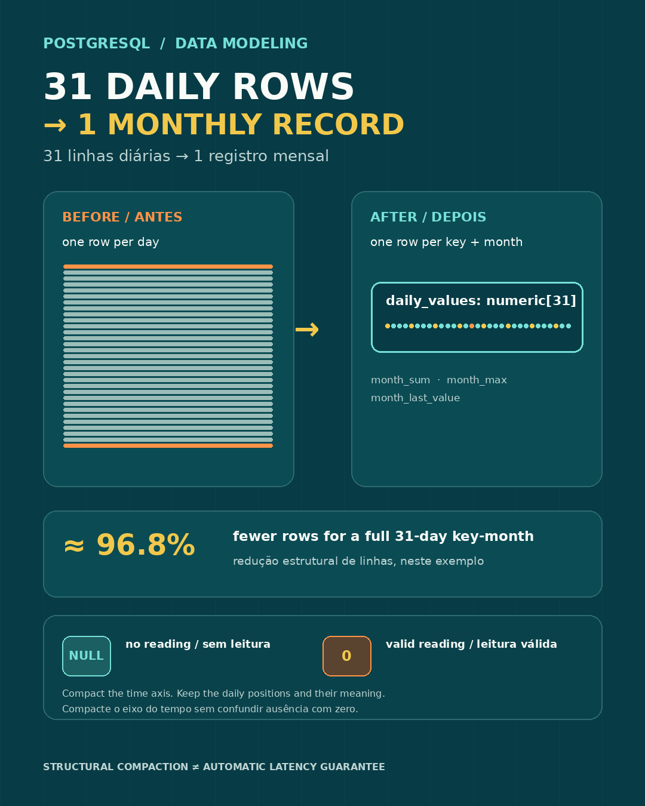
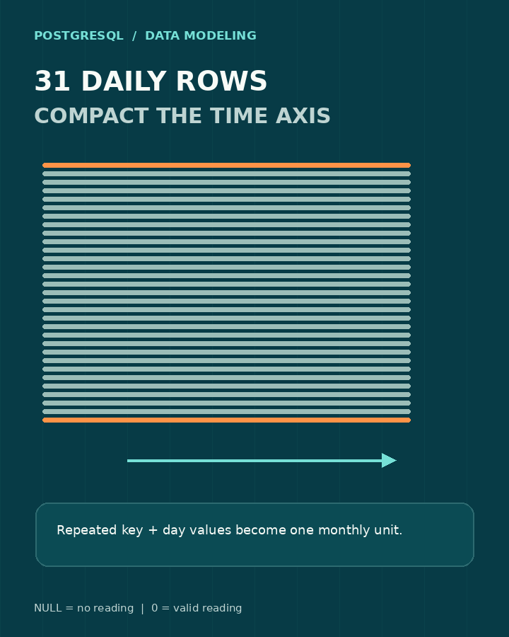
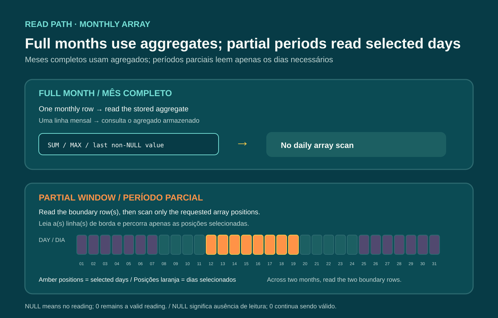

🇧🇷 Português

# Quando 31 linhas viram uma: reduzindo cardinalidade com arrays no PostgreSQL

*Como uma representação mensal preserva a leitura diária sem continuar pagando o custo de uma linha por dia.*

Uma tabela de consumo pode crescer por um motivo que parece inocente: as mesmas dimensões se repetem todos os dias. Quando cliente, produto, recurso e tipo mudam pouco, o tempo passa a ser representado por mais linhas — mesmo quando a consulta do negócio pensa em meses.

Vale uma precisão importante: o problema não era simplesmente uma coluna de baixa cardinalidade. Era a baixa variedade da combinação contextual, multiplicada pela dimensão diária. A mesma chave aparecia repetidamente, uma vez por dia, e a tabela física carregava essa repetição para cada consulta de faturamento.

A solução foi compactar o eixo do tempo sem perder consultas parciais: uma linha por chave e mês, com um array PostgreSQL para valores diários.

## A tabela estava respondendo a uma pergunta diferente da aplicação

A representação bruta era boa para registrar cada chegada de consumo. Cada registro carregava a identidade do cliente, o recurso, o produto, o tipo de volume e as datas do período.

O problema aparecia na leitura. O faturamento precisava responder perguntas como “qual foi o volume desse recurso durante este mês?” ou “qual foi o consumo entre o dia 15 e o dia 14 do mês seguinte?”. Para isso, precisava varrer linhas diárias que compartilhavam quase toda a mesma chave.

A tabela tinha granularidade de evento diário, enquanto o leitor trabalhava com uma granularidade mensal ou com uma pequena janela entre duas datas. O armazenamento estava preservando detalhes, mas também estava cobrando o preço da repetição em toda leitura.

## A chave mensal concentra o tempo sem apagar o significado diário

A representação mensal mantém as dimensões usadas no lookup e troca a repetição de linhas por uma estrutura posicional. A chave de negócio e o período continuam relacionais; os valores diários ficam agrupados em `numeric[31]`, acompanhados por agregados de leitura.

![Estrutura mensal: da repetição de linhas diárias para uma chave mensal com numeric[31]](../../../04-midias/monthly-array-cardinality/cardinality-before-after.svg)

A posição do array corresponde ao dia. A primeira posição representa o primeiro dia do mês; a trigésima primeira, o último possível. Dias sem leitura permanecem `NULL`. Isso é diferente de zero: zero é uma leitura válida, enquanto `NULL` significa que não houve leitura naquele dia.

O array não substitui o modelo relacional: a chave continua em colunas filtráveis e indexáveis. Somente o eixo diário, posicional e limitado, vira vetor.

## Um exemplo de escala: 31 linhas para 1

Considere uma chave que recebe uma leitura por dia durante um mês:

Essa é uma redução de representação, não uma promessa automática de latência. O material técnico observou uma tabela bruta na ordem de dezenas de gigabytes e estimou a representação mensal na ordem de poucos gigabytes, incluindo índices. A estimativa não substitui uma medição de produção.

O mesmo cuidado vale para o tempo de consulta. Antes da troca, alguns cenários de faturamento chegavam perto de uma hora. O material técnico não registra um benchmark público comparável depois da mudança. O que mudou foi o trabalho potencial da leitura: um mês completo usa o agregado armazenado; um período com corte busca as linhas mensais de borda e percorre apenas as posições necessárias do array.

A comparação correta mede o mesmo cenário antes e depois: tempo total, percentis, linhas lidas e buffers. O artigo pode afirmar a compactação estrutural, não inventar um tempo final.

## O ganho vem do contrato entre escrita e leitura

O ganho de modelagem vem da combinação de três decisões.

Primeiro, a tabela reduz a repetição física: uma chave mensal passa a ocupar uma linha, em vez de uma linha para cada dia recebido.

Segundo, a escrita recalcula agregados derivados do vetor. A soma, o maior valor e a última leitura ficam disponíveis para o caminho de mês fechado. Assim, uma consulta que precisa do mês inteiro não precisa transferir o array nem percorrer todas as posições.

Terceiro, a leitura conhece a fronteira do período. Se o intervalo cobre o mês inteiro, usa o agregado correspondente ao tipo de volume. Se começa ou termina no meio do mês, carrega o vetor da borda e percorre somente as posições necessárias.

Isso permite manter a regra de soma, máximo e acumulado sem transformar todos os meses em uma sequência de linhas artificiais.

## Períodos parciais exigem semântica explícita

A parte mais importante não foi declarar `numeric[]`. Foi definir o que cada posição significa e como ela participa do cálculo.

Para uma janela parcial, a aplicação converte o dia em índice — dia 1 vira posição 0 — e percorre o intervalo inclusivo. Para `Sum`, soma os valores presentes. Para `Max`, preserva o maior valor. Para `Accumulative`, escolhe a última posição não nula na ordem cronológica.

A mesma regra funciona quando o período atravessa dois meses: a primeira linha fornece a fatia final do primeiro mês e a segunda fornece a fatia inicial do próximo. Em muitos casos de corte, isso limita a consulta a duas linhas por chave, sem perder a capacidade de respeitar a data de início e a data final.

Esse desenho também força uma distinção que costuma causar bugs: ausência de leitura não é o mesmo que volume zero. Um array cheio de `NULL` não deve ser tratado como um mês com consumo zero se a regra de negócio precisa reconhecer a ausência de dados. Ao mesmo tempo, uma posição explicitamente igual a zero deve continuar participando do cálculo.

## O trade-off: compactar não é recuperar o passado

Uma estrutura mensal é eficiente para o padrão de leitura escolhido, mas não é uma reconstrução perfeita da tabela bruta. Se múltiplos eventos foram compactados na mesma posição, a representação mensal preserva o valor definido pela regra de escrita, não todos os eventos individuais.

Por isso, a migração precisa separar duas perguntas: a nova tabela representa corretamente o domínio que se quer consultar? E ela contém todo o histórico necessário antes de a leitura ser trocada?

No caso analisado, a troca de leitura foi condicionada à população histórica e à verificação de divergências. A tabela mensal foi criada e alimentada antes de se tornar a fonte do faturamento. Esse portão é tão importante quanto o array: compactar dados sem conferir o histórico apenas transforma uma tabela lenta em uma tabela rápida e incompleta.

## A regra prática

Arrays do PostgreSQL fazem sentido quando o valor tem uma dimensão posicional limitada, o acesso normalmente acontece pela chave que o contém e os cálculos da estrutura podem ser mantidos consistentes.

Eles não substituem índices, não resolvem qualquer problema de cardinalidade e não devem esconder eventos que ainda precisam ser auditados individualmente.

Neste caso, a mudança funcionou porque o modelo passou a refletir a pergunta real da aplicação: para uma chave conhecida, consultar o consumo de um mês — ou uma pequena fatia dele — em vez de procurar o mês inteiro dentro de linhas que repetem a mesma identidade diária.

----------------------------

🇺🇸 English

# When 31 Rows Become One: Reducing Cardinality with PostgreSQL Arrays

*How a monthly representation preserves daily readings without continuing to pay the cost of one row per day.*

A consumption table can grow for an innocent-looking reason: the same dimensions repeat every day. When customer, product, resource, and volume type change rarely, time is represented by more rows—even when the business query thinks in months.

One distinction matters: this was not simply a low-cardinality column problem. It was a low-variety contextual key multiplied by a daily dimension. The same key appeared repeatedly, once per day, and the physical table carried that repetition into every billing query.

The solution was to compact the time axis without losing the ability to query partial periods: one row per key and month, with a PostgreSQL array for daily values.

## The table was answering a different question than the application

The raw representation was useful for recording each incoming consumption reading. Each record carried the customer, resource, product, volume type, and period information.

The problem appeared during reads. Billing needed to answer questions such as “what was the volume for this resource during the month?” or “what was consumed between the 15th and the 14th of the next month?” To answer them, it had to scan daily rows that shared almost the entire key.

The table had daily-event granularity, while the reader worked with a monthly granularity or a small window between two dates. The storage preserved detail, but it also charged the cost of repetition on every read.

## The monthly key compacts time without losing daily meaning

The monthly representation keeps the dimensions used by the lookup and replaces repeated rows with a positional structure. The business key and period remain relational; daily values are grouped in `numeric[31]`, alongside derived reading aggregates.

![Monthly structure: repeated daily rows become one monthly key with numeric[31]](../../../04-midias/monthly-array-cardinality/cardinality-before-after.svg)

The array position corresponds to the day. The first position represents the first day of the month; the thirty-first represents the last possible day. Days without a reading remain `NULL`. That is different from zero: zero is a valid reading, while `NULL` means no reading was received for that day.

The array does not replace the relational model: the key remains in filterable, indexable columns. Only the bounded, positional daily axis becomes a vector.

## A scale example: 31 rows become 1

Consider a key that receives one reading per day during a month:

This is a representation reduction, not an automatic latency promise. The technical material observed a raw table in the tens-of-gigabytes range and estimated the monthly representation in the low-single-digit-gigabyte range, including indexes. The estimate is not a production measurement.

The same care applies to query time. Before the switch, some billing scenarios approached one hour. The technical material does not publish a comparable after benchmark. What changed was the potential read work: a full month uses its stored aggregate; a cutoff period reads the monthly boundary rows and scans only the required array positions.

The correct comparison measures the same scenario before and after: total time, percentiles, rows read, and buffers. The article can claim structural compaction, not invent a final query time.

## The gain comes from the write-read contract

The modeling benefit comes from three decisions working together.

First, the table reduces physical repetition: one monthly key occupies one row instead of one row for every received day.

Second, the write path recalculates derived aggregates from the vector. The sum, maximum, and last reading are available for the full-month path. A query that needs the whole month does not need to transfer the array or walk every position.

Third, the read path understands the period boundary. If the interval covers a full month, it uses the aggregate for the volume type. If it starts or ends inside a month, it loads the boundary array and scans only the required positions.

This preserves the rules for sum, maximum, and accumulative readings without turning every month back into artificial daily rows.

## Partial periods require explicit semantics

The important part was not declaring `numeric[]`. It was defining what each position means and how it participates in the calculation.

For a partial window, the application converts the day to an index—day 1 becomes position 0—and scans the inclusive range. For `Sum`, it adds present values. For `Max`, it keeps the largest value. For `Accumulative`, it selects the last non-null position in chronological order.

The same rule works when a period crosses two months: the first row supplies the ending slice of the first month and the second supplies the beginning slice of the next one. For many cutoff-period cases, this limits the lookup to two rows per key while preserving the start and end dates.

The design also forces a distinction that often causes bugs: no reading is not the same as a zero volume. An array full of `NULL` should not be treated as a month with zero consumption when the business rule needs to recognize missing data. At the same time, an explicit zero must remain part of the calculation.

## The trade-off: compacting is not recovering the past

A monthly structure is efficient for its chosen read pattern, but it is not a perfect reconstruction of the raw table. When multiple events are compacted into the same position, the monthly representation preserves the value defined by the write rule, not every individual event.

That is why a migration must answer two separate questions: does the new table represent the domain that will be queried? And does it contain all the history required before the read path changes?

In the case behind this article, the read switch was conditioned on historical population and divergence checks. The monthly table was created and populated before becoming the billing source. That gate matters as much as the array: compacting data without checking history only turns a slow table into a fast incomplete one.

## The practical rule

PostgreSQL arrays make sense when a value has a bounded positional dimension, access normally starts from the key that contains it, and the structure's derived calculations can remain consistent.

They do not replace indexes, solve every cardinality problem, or hide events that still need individual auditing.

The change worked because the model began to reflect the application's real question: for a known key, read consumption for a month—or a small slice of it—instead of searching an entire month through rows that repeat the same daily identity.

## Publication Notes

- Draft based on an internal implementation and issue; names, paths, identifiers, URLs, and exact operational metrics were generalized.
- Review the claims about performance and storage with public measurements before publication.

## Registro de mídias (nota interna — não publicar)

| Mídia | Posição/uso | Referência relativa ao draft |
|---|---|---|
| `monthly-array-cardinality-hero.jpg` | Capa do artigo | [abrir mídia](../../../04-midias/monthly-array-cardinality/monthly-array-cardinality-hero.jpg) |
| `cardinality-before-after.svg` | Após a seção “A chave mensal concentra o tempo sem apagar o significado diário” | [abrir mídia](../../../04-midias/monthly-array-cardinality/cardinality-before-after.svg) |
| `monthly-array-cardinality-infographic.png` | Após a tabela de escala, em “Um exemplo de escala: 31 linhas para 1” | [abrir mídia](../../../04-midias/monthly-array-cardinality/monthly-array-cardinality-infographic.png) |
| `period-boundary-array.svg` | No início de “Períodos parciais exigem semântica explícita” | [abrir mídia](../../../04-midias/monthly-array-cardinality/period-boundary-array.svg) |
| `rows-to-array.gif` | Após a explicação dos três ganhos de modelagem | [abrir mídia](../../../04-midias/monthly-array-cardinality/rows-to-array.gif) |
